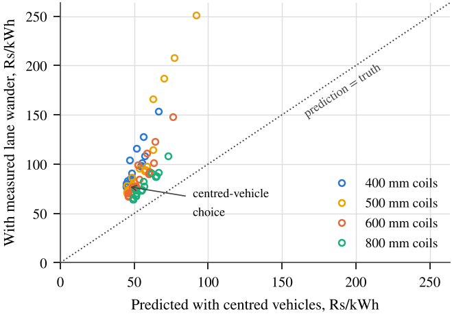
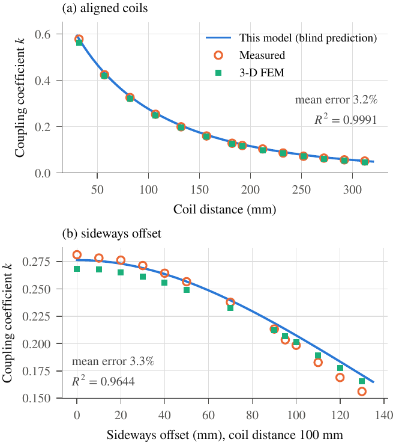
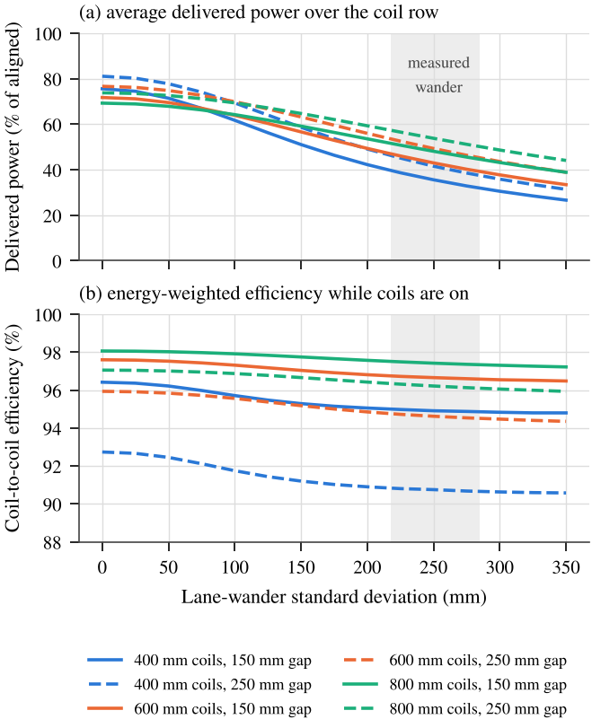
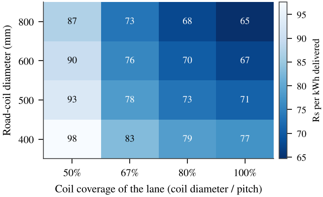
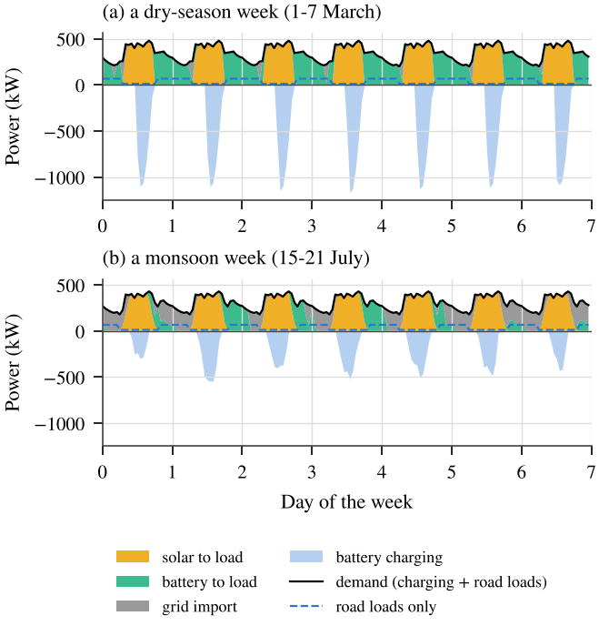
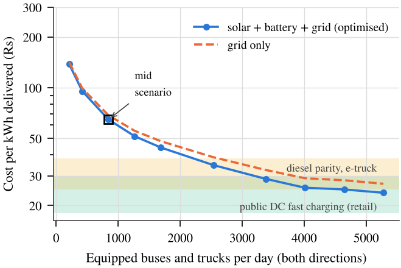
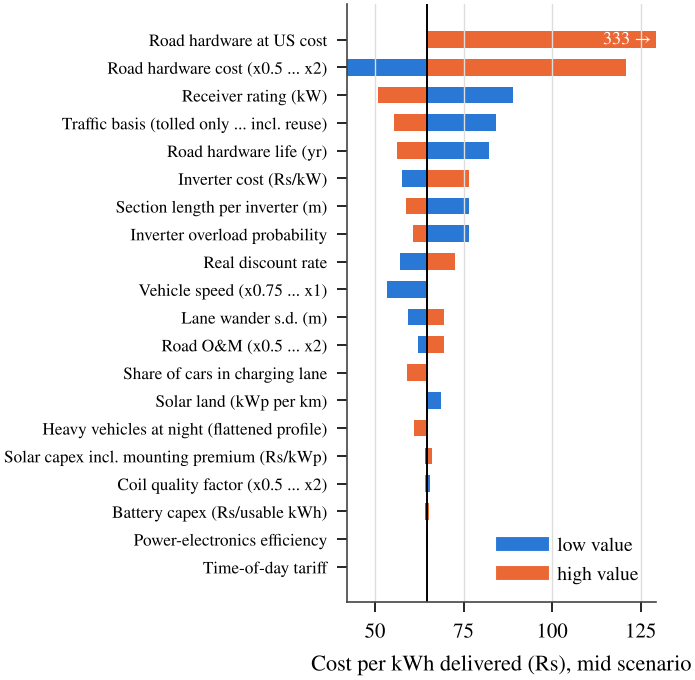

# Lane Wander, Utilization and Local Supply in Wireless-Charging Highways

**Code and data for:** K. Mehra and M. K. Singh, *"Lane Wander, Utilization and Local Supply in Wireless-Charging
Highways: A Physics-Informed Planning Study of an Indian National Highway"* (manuscript submitted for review, 2026).
Department of Electronics and Communication Engineering, National Institute of Technology Delhi.

---

## What this repository does

Dynamic wireless power transfer (DWPT) roads charge electric vehicles through coils buried in the lane. Planning
studies usually assume that vehicles drive exactly centred over the coils. Real vehicles wander sideways in the lane
(standard deviation about 250 mm), which is comparable to the radius of a road coil.

This repository carries a **coil model validated against 28 published measurements** through **measured lane
wander**, **real traffic counts**, **hourly solar, battery and grid optimisation**, and **Indian costs and tariffs**
to the **cost of every kilowatt-hour delivered to a vehicle**, for a 10 km section of NH-48 near Pune, India.



## Key results (mid adoption scenario)

| Result | Value |
|---|---|
| Delivered power lost to lane wander (thresholds up to 90 %) | 27–61 % |
| Coil efficiency lost to lane wander | at most 3.3 percentage points |
| Delivered energy overstated by planning with centred vehicles (92 designs) | 38–193 % (median 71 %) |
| Least-cost layout | full lane coverage, 800 mm coils |
| Cost per kWh delivered to vehicles | Rs 65 (5–95 % range Rs 37–120) |
| Share of that cost due to road hardware | 87 % |
| Energy supplied by right-of-way solar + battery | 85 % |
| CO₂ avoided | about 1,800 t per year |
| Equipped buses and trucks per day for diesel parity (upper end) | about 2,200 |

All numbers are produced by the code in this repository; `results/console_output.txt` is the log of the run that
produced them.

## Repository layout

| Folder / file | Contents |
|---|---|
| `src/wpt_model.py` | Coil model: Maxwell and Grover mutual inductance, spiral coils, self-inductance, coupling |
| `src/coupler_layer.py` | Power transfer, switch-on rule, row averaging, lane-wander averaging, coil-size scaling |
| `src/corridor.py` | Traffic, energy per vehicle, hourly demand, compound-Poisson inverter sizing, firm power, road loads |
| `src/pv_model.py` | Hourly solar output per kWp from a typical-year weather file (pvlib) |
| `src/optimiser.py` | Least-cost solar + battery + grid, linear programme over 8,760 hours (HiGHS) |
| `src/run_model.py` | Runs the whole study: design sweep, scenarios, break-even, sensitivity, Monte Carlo, weather check |
| `scripts/make_figures.py` | Builds every figure from `results/` |
| `validation/` | Blind validation of the coil model against published measurements |
| `data/` | Toll counts (MSRDC), hourly traffic profile (UPEIDA); weather download instructions |
| `results/` | All result tables (CSV), summary (JSON), run log |
| `figures/` | All figures (PDF for print, PNG for viewing) |
| `docs/FORMULAS.md` | **Every equation used, with the function that implements it** |
| `docs/METHODS.md` | The method in plain words |
| `docs/DATA_SOURCES.md` | **Every input number, its value and its source** |
| `docs/RELATED_WORK.md` | Closest published work and what is new here |

## How to reproduce

Requirements: Python 3.10 or newer.

```bash
git clone https://github.com/mehrakrish/wireless-charging-highway-nh48.git
cd wireless-charging-highway-nh48
pip install -r requirements.txt
```

1. Download the Pune weather files as described in `data/weather/README.md`.
2. Run the study (about 40 minutes; it solves about 140 linear programmes of 8,760 hours each):
   ```bash
   python src/run_model.py data/weather/IND_MH_Pune.430630_TMYx.2011-2025/IND_MH_Pune.430630_TMYx.2011-2025.epw
   ```
3. Build the figures:
   ```bash
   python scripts/make_figures.py
   ```
4. Validate the coil model (optional, about 1 minute):
   ```bash
   cd validation && python run_study1.py
   ```

Your numbers should match `results/console_output.txt`.

## Result files

| File | What it contains |
|---|---|
| `A_physics_wander.csv` | Delivered power and efficiency, centred vs. wander, for every design and vehicle class |
| `B_design_sweep_mid.csv` | All 96 coil designs (92 valid) with the supply optimised for each |
| `C_centred_vs_wander.csv` | Prediction with centred vehicles vs. with measured wander, for every design |
| `D_scenarios_best_design.csv` | Least-cost design under low, mid and high adoption |
| `E_breakeven_heavy.csv` | Cost per kWh vs. equipped buses and trucks per day |
| `F_sensitivity.csv` | One-at-a-time sensitivity on 20 inputs |
| `M_monte_carlo.csv` | 300 joint random draws of the uncertain inputs |
| `W_weather_robustness.csv` | Base case with four Pune typical-year weather files |
| `summary.json` | Best design, base case, centred-planning choice, Monte Carlo range, harvesting bound |

## Figures

| | |
|---|---|
|  |  |
| Validation of the coil model | Lane wander: power vs. efficiency |
|  |  |
| Cost per kWh vs. coil size and coverage | Hourly dispatch of solar, battery and grid |
|  |  |
| When the road pays | Sensitivity |

## Main assumptions and limitations

- Coreless circular coils, validated up to 130 mm lateral offset; ferrite or DD pads may behave differently.
- Lane wander is taken as normal with standard deviation 250 mm (measured range 218–285 mm).
- No Indian DWPT costs are published; Chinese component costs are used, with US costs as the upper bound.
- Equipped-vehicle shares are explicit scenarios, not forecasts; break-even is reported per equipped vehicle.

Full details: `docs/METHODS.md` and the paper.

## Citation

See `CITATION.cff`, or cite:

> K. Mehra and M. K. Singh, "Lane Wander, Utilization and Local Supply in Wireless-Charging Highways: A
> Physics-Informed Planning Study of an Indian National Highway," manuscript submitted for review, 2026.

## Licence

Code: MIT (`LICENSE`). Data, results, figures and documentation: CC BY 4.0 (`LICENSE-DATA.md`).

## Contact

Krish Mehra, National Institute of Technology Delhi — mehrakrish2609@gmail.com

Generative AI tools assisted with literature search, data extraction and code development; all equations, code and
results were checked by the authors.
